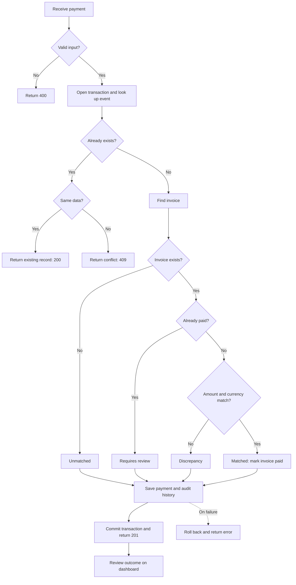
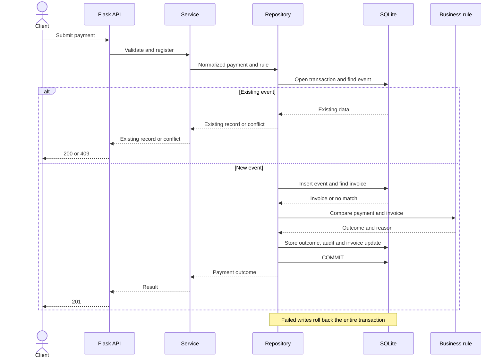

# Project diagrams

Reconciliation happens within the same HTTP request. Invoices are registered beforehand.

## Flowchart

## Sequence diagram

A unique key prevents duplicate events. A transaction prevents partial writes. The dashboard reads the stored outcome and audit history.
